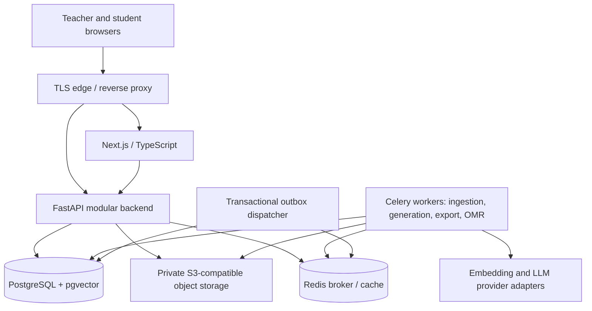

# Eduvia Architecture Design

Status: proposed technical design, not an implemented system. Date: 2026-10-19.

## 1. Basis, goals, and boundaries

This design interprets the existing `README.md` as the product specification. The referenced conversation was inspected, but its edited specification and assistant artifacts were not retrievable as substantive text. No additional specification is assumed. Technology choices, state machines, service boundaries, and operational targets below are proposals requiring validation during implementation.

Eduvia serves individual teachers, students, and eventually schools, initially in Vietnam. The first pilot should support roughly 10–20 teachers, one education level, and one or two subjects. Its complete first teaching loop is: authorized source material → AI draft → teacher review → published learning materials and quiz → student submission → deterministic grading → teacher-visible results. OMR follows a stable online workflow.

[DATABASE.md](DATABASE.md) defines the matching persistence model; [README.md](README.md) records product scope. PostgreSQL is the source of truth for ownership, publication, attempts, grades, jobs, and usage. Redis is disposable infrastructure. An LLM response, queue message, cached permission, or scan detection is never an authoritative grade or access decision.

## 2. Architecture and deployment units

Start with a modular monolith: one FastAPI codebase with explicit domain modules and one shared PostgreSQL database. Run HTTP and Celery workers as separate processes from the same backend release. Avoid independent microservices until measured load or operational boundaries justify them.

| Module | Responsibilities | Authoritative entities |
|---|---|---|
| Identity and workspaces | Sessions, memberships, invitations, workspace switching, authorization | users, workspaces, workspace_members, workspace_invites |
| Curriculum and knowledge | Licensed catalog, private uploads, parsing, versions, retrieval | curriculum_nodes, knowledge_licenses, documents, document_versions, document_chunks |
| AI content | Templates, prompt orchestration, generation provenance, review, exports | generation_jobs, generation_sources, content_items, content_revisions |
| Teaching | Classes, roster, materials, assignments | classes, students, class_enrollments, assignments, assignment_materials |
| Assessment | Question banks, immutable exam snapshots, attempts, deterministic scoring | questions, question_revisions, exam_versions, quiz_attempts, student_answers |
| Paper assessment | Answer-sheet identity, OpenCV recognition, human review | answer_sheets, scan_jobs, recognized_answers, grading_reviews |
| Billing and metering | Plans, entitlements, reservations, settlement, webhooks | subscriptions, usage_reservations, usage_events, billing_events |
| Platform operations | Durable jobs, delivery, audit, retention | background_jobs, outbox_events, audit_events, deletion_requests |

Modules invoke each other through service interfaces rather than modifying each other's tables arbitrarily. A single transaction may span modules for invariants such as attempt submission and grading-job creation. External effects occur after commit through the outbox.

## 3. Frontend and API contracts

Use Next.js, React, TypeScript, Tailwind CSS, and shadcn/ui for a mobile-first teacher interface and student portal. Begin with responsive web pages; introduce PWA installation and offline material caching after validating usage. Never cache private student records or answer keys in a public service worker cache. Offline quiz submission is outside the MVP.

FastAPI owns domain authorization and validation. Next.js may render pages server-side or proxy requests, but must not become a second authorization authority. Generate TypeScript request/response types from a reviewed OpenAPI contract. Use cursor pagination for histories and rosters, bounded request sizes, consistent error codes, and UTC timestamps with local display.

Use a maintained identity provider or a separately reviewed authentication implementation. Prefer secure, HttpOnly, SameSite cookies for browser sessions, CSRF protection for cookie-authenticated mutations, short-lived sessions with rotation, and explicit CORS origins. Provider credentials stay on the backend. Require step-up authentication for ownership changes and MFA for platform administrators. Server-rendered authenticated fetches must disable shared caching.

Example route families (proposed contracts):

| Route | Behavior |
|---|---|
| `POST /v1/workspaces/{w}/uploads` | Authorize type/size, allocate object record, return short-lived upload URL |
| `POST /v1/workspaces/{w}/documents/{d}/ingest` | Validate uploaded object; return durable job ID with 202 |
| `POST /v1/workspaces/{w}/generations` | Validate sources and entitlement, reserve quota, enqueue job |
| `GET /v1/workspaces/{w}/jobs/{id}` | Return authorized job state and safe progress |
| `POST /v1/workspaces/{w}/exams/{id}/publish` | Validate and freeze an exam version and answer key |
| `POST /v1/workspaces/{w}/assignments/{id}/attempts` | Check enrollment, availability, attempt limit; create or return attempt |
| `PUT /v1/workspaces/{w}/attempts/{id}/answers/{item}` | Save own answer using optimistic revision |
| `POST /v1/workspaces/{w}/attempts/{id}/submit` | Atomically freeze responses and schedule scoring |
| `POST /v1/workspaces/{w}/scans` | Create authorized sheet-specific scan job |

Mutation idempotency keys are scoped to actor, workspace, and operation, with a request hash: reuse with different input returns conflict. Responses use DTO allowlists; student payloads omit keys, internal prompts, provider responses, and unreleased explanations. SSE is optional for progress; polling is sufficient for the MVP.

## 4. Tenancy, ownership, and permission model

A workspace is the tenant boundary and data owner. A user may own one active personal workspace and belong to several schools. Personal workspace ownership and school membership are independent of plan payment. School enrollment does not convert the personal workspace or automatically expose its documents, question bank, or classes.

Workspace roles are owner, admin, teacher, and student. Classroom teacher assignments and student enrollments further constrain access. Students can read published materials assigned to their enrolled class, operate their own available attempts, and read their own released grades. A workspace membership alone does not grant a student broad workspace reads. Platform administrators use a separate audited control plane; ordinary admin accounts have no automatic access to private tenant content.

MVP content is workspace-visible to authorized teaching staff; personal workspaces have one teacher owner and may contain student memberships for that teacher's classes. Creating a personal workspace does not invite other teachers. Deleted, closed, or suspended workspaces deny ordinary data access; billing delinquency is a separate entitlement state and does not automatically suspend the workspace. Per-resource staff ACLs and school departments arrive with school collaboration. Private student records always use class/own-record restrictions. UI navigation is never a security boundary.

Use PostgreSQL RLS plus backend operation-level authorization. Every tenant relation includes a non-null workspace ID; composite foreign keys prevent cross-tenant links. Set verified actor and workspace context transaction-locally, including worker transactions. Missing context denies access. Connection pooling must not leak session state. Runtime roles must neither own tables nor have BYPASSRLS. See `DATABASE.md` for policy examples and limitations.

**Joining a school:** accept invitation → create school membership → switch active workspace explicitly. Personal data stays personal. When school collaboration ships, reuse supported lesson plans/study guides through an explicit copy into the school, subject to source licensing. Document, question-bank, and exam copying require their own typed provenance and validation workflows before being enabled. The copy gets a new ID, school ownership, provenance, and independent revision history. Do not copy student records through this content flow. Cross-workspace live sharing is deferred; when introduced, use revocable grants, legal basis, source-right checks, and audit. Leaving a school revokes school access but leaves school-owned copies in the school and personal originals in the personal workspace. No automatic ownership transfer occurs.

## 5. Storage and document ingestion

Store binary uploads, generated exports, and scans in private S3-compatible storage. PostgreSQL stores object keys, MIME types, sizes, checksums, lifecycle state, and owner scope. Use random object keys; a workspace path prefix is organizational metadata, not authorization. Downloads require a fresh API permission check and a short-lived signed URL. Revocation prevents issuing new URLs; a previously issued URL may remain usable until expiry. Use a 60-second default download TTL for sensitive records, and an authenticated streaming endpoint when immediate revocation is required. Treat a signed URL as a bearer credential; never log it.

Ingestion workflow:

1. Reserve workspace storage quota and issue a constrained upload URL.
2. On completion, verify actual size, checksum, content type, and object existence. Quarantine unsupported or suspicious inputs. Use sandboxed parsers with CPU, memory, page, and time limits; reject encrypted or malformed files with actionable feedback.
3. Create an immutable `document_versions` row and durable ingestion job. Parse PDF/DOCX/text, preserving page or section locations. OCR for image-only sources is optional and separately metered.
4. Normalize text, chunk by section with bounded overlap, attach curriculum and source metadata, generate embeddings, and store lexical search vectors.
5. Stage all chunks under that version. Mark the version ready and change the document's active version atomically only after successful validation. Failed versions never partially replace working retrieval content.
6. Retain safe error diagnostics and allow explicit retry. Deduplicate repeated execution by version and stage.

Use an explicit embedding model identifier, dimension, and chunker version. Proposed initial vector size is 1536 only if the chosen provider/model matches; confirm before migration. A model change creates a parallel embedding generation and index; do not mix incompatible vectors or silently reinterpret old embeddings.

## 6. Authorized RAG

Keep shared licensed catalog tables separate from tenant private knowledge tables. A shared document must have recorded permission for the intended operations, effective dates, and distribution restrictions. Shared is not synonymous with public. Private uploads require uploader rights attestation and are never automatically promoted to the shared catalog.

For each retrieval request:

1. Resolve authenticated workspace and teacher permissions, selected curriculum, requested purpose, and current license entitlements on the server.
2. Query only ready, non-deleted, authorized private document versions in the active workspace and separately query entitled shared versions. Default to each document's active version; an explicitly pinned older version is allowed only if still authorized and not withdrawn. Apply permission and license predicates in SQL before any text leaves the database. Never retrieve globally and filter only after retrieval.
3. Combine keyword and vector candidates with bounded per-source budgets, deduplicate, and optionally rerank. Tune Vietnamese tokenization and ranking with a small labeled curriculum set; basic lexical search is a baseline, not a guarantee of linguistic quality.
4. Supply bounded context to the provider with stable source IDs, page/section references, and instructions to treat retrieved content as data. Strip active content; tools may not execute instructions found in documents.
5. Generate schema-constrained output. Verify cited IDs against supplied passages and check that cited passages plausibly support the claims. Flag unsupported content; do not claim automated validation guarantees factual correctness.
6. Persist generation inputs, model/prompt versions, source version/chunk IDs, citations, and cost metadata. Show insufficient-context warnings and allow teacher correction before publication.

Recheck license validity and source access at generation time and export time. License revocation blocks new retrieval and exports immediately; historical references may retain identifiers and hashes rather than restricted text. Existing derivatives require a license-specific withdrawal policy. Cache keys include workspace, authorization version, source versions, model, and license revision. Start without shared retrieval-result caching to reduce leakage risk.

## 7. AI generation and content lifecycle

Provide a provider-neutral adapter for embedding, structured generation, timeout handling, and usage reporting. Keep orchestration in application services; adopt LlamaIndex or LangChain only where it reduces complexity. No per-teacher fine-tuning is required.

Lesson plans and study guides use `content_items` plus immutable `content_revisions`. Exams use the question bank and exam snapshots. Generation jobs record subject, grade, textbook/lesson selection, objectives, duration, template version, difficulty distribution, and source selection. Use JSON schema validation, required-field checks, question/option consistency checks, and deterministic arithmetic checks on scoring matrices. Failed validation yields a reviewable failed draft or a bounded repair attempt, never automatic publication.

Authoring lifecycle: `draft → in_review → published → archived`; the review step is recorded on content revisions, while exam publication records the reviewer directly. Published payloads stay immutable after archival. Edits create a new revision; a draft revision may coexist with the published revision assigned to students. Teacher approval records the reviewer and time. Export jobs reference a specific revision, template, and audience (`teacher` or `student`); private Word/PDF artifacts carry provenance and must respect licensing. Teacher editions may include keys and notes. Student editions are generated separately without keys, teacher-only notes, or unreleased solutions; hiding sections in the browser is insufficient. Sharing a source document requires explicit teacher selection and distribution rights. An assigned material grants access only to its pinned published revision, not the rest of its source corpus. A provider outage cannot block manual authoring, editing, or existing quiz delivery.

AI output is advisory. MVP official online grades use deterministic answer keys. Essay grading, handwritten recognition, student tutoring, and adaptive learning remain future capabilities requiring separate evaluation and review design.

## 8. Student quiz and grade flow

1. Teacher reviews question wording, options, keys, scoring, and curriculum coverage. Publishing freezes `exam_versions`, ordered items, and server-only keys; later bank edits cannot affect existing exams.
2. Assignment pins an exam version and class, availability window, time limit, attempt limit, and release policies for scores and solutions. Validate all items are single-choice for MVP online grading. Start with one attempt by default and `manual` release for both scores and solutions; teachers may select `after_close` when a closing time exists. Retakes default to the latest submitted non-void attempt for the gradebook; alternative policies are future.
3. Student joins through a rate-limited expiring class invitation. Server maps the account to a workspace-local student record and active enrollment. Class codes are invitations, not read credentials.
4. Starting an attempt serializes by assignment/student, enforces attempt limits, and stores server start/deadline times. The deadline is the earlier of assignment close and start plus time limit, omitting absent bounds; both absent means an untimed open assignment. Voided attempts remain auditable but do not consume the attempt limit; only an authorized teacher may void an attempt with a recorded reason. Attempt numbers always increase and are never reused. A new idempotency key still returns an existing in-progress attempt. A retry with the same key and inputs returns the same result; changed inputs return conflict.
5. Autosaves use an answer revision number to prevent stale overwrite. Server checks ownership and deadline on every write. Answers identify immutable exam items; never accept a score or correct-answer flag from the client.
6. Submission locks the attempt, rejects late answer writes, freezes the answer set, and inserts a grading job/outbox event in the same transaction. Use fresh server wall-clock time after acquiring the lock; reject answer writes at or after the deadline; no transport grace is implicit. A submit request received after expiry finalizes only answers already saved before the deadline, with the deadline as the effective submission time and the actual processing time recorded separately. A scheduled sweeper uses the same path for expired online attempts. Paper attempts are excluded. Concurrent submit and autosave cannot produce an unrecorded answer change.
7. Deterministic grading records per-item outcomes, a versioned grading result, algorithm/key version, and totals. Absent responses score zero; invalid option IDs are rejected. MVP single-choice scoring uses no negative or partial credit.
8. Online objective grades can be finalized automatically under the assignment policy, then released separately. Student access requires release. Teacher overrides create a new official grade revision and audit entry with a reason; preserve original results.

Analytics use current approved grades and count each student once per assignment. The MVP completion denominator is active class enrollments at query time, visibly labeled with the query time; withdrawn students are excluded and the count may change. Completion counts students among those active enrollments with at least one non-void submitted attempt. Grade averages use the latest submitted non-void attempt per student; if it is awaiting grading, show it as pending rather than falling back to an older score. Missing submissions are shown separately and do not silently become zero scores. Question/topic reports use frozen exam-item objective mappings. An item linked to several objectives contributes to each; label overlapping topic groups and never sum their scores into a second exam total. Show sample counts, pending grades, and observed outcomes separately from AI interpretation. Avoid labeling ability from a single quiz. Score release and solution release are separate; a solution must never release before an open retake opportunity closes. MVP `after_close` requires a finite closing time and runs only after it. `manual` solution release requires the teacher to close the assignment to new attempts and confirm that all in-progress attempts have ended. Answer explanations remain hidden until solution release, even in API errors and preloaded page data. Class archival or completed/withdrawn enrollment blocks new attempts and answer writes; an active workspace member may still read their own retained attempt history and released grades. Suspension or leaving the workspace revokes that access.

## 9. OMR pipeline (after online pilot)

Use standardized, versioned answer-sheet templates with QR identifiers and alignment markers. Each issued `answer_sheets` record binds workspace, assignment, exam version, student, and attempt. QR payload contains an opaque sheet identifier and a signature/key version; it contains no student name or answer key. Verify signature and database binding server-side; a valid QR alone does not authorize access.

Upload → image safety/quality validation → orientation and perspective correction → marker/QR checks → bubble detection → confidence and ambiguity classification → deterministic proposed scoring → teacher review → approved grade revision. Record template, detector, threshold, key, and source-image versions. Each grading result points to its exact scan and immutable effective answers after corrections; result items must belong to the same exam version as the attempt. Thresholds must be calibrated on pilot photographs; do not invent a universal accuracy threshold.

Reject unknown/mismatched sheets, missing markers, and unusable images. Flag blank, multiple-mark, erased, cropped, or low-confidence detections for review. Preserve raw detections separately from teacher corrections. Repeated scans create candidates, not duplicate official grades. A teacher selects the current accepted scan and approves the result; finalization locks the paper attempt and atomically records its effective response snapshot, submission, approved result, grade revision, and audit event. Paper attempts are issued by a teacher and do not use online autosave or deadline sweeping. Rescanning can replace the current accepted scan under the same lock, preserving prior scan approvals and result links; only one grade revision is current. The first OMR release uses fixed item and option order. Sheet issuance freezes the bubble-to-item/option mapping and its hash; randomized forms require a separate explicit form mapping and are deferred. Review screens show cropped evidence and proposed/edited answers. Regrading creates a new result revision linked to its predecessor. Batch uploads, handwriting OCR, and essay evaluation are future scope.

## 10. Jobs, failure handling, and consistency

Use separate Celery queues for ingestion/embedding, generation, export, and OMR, with bounded concurrency and per-workspace fairness. PostgreSQL `background_jobs` tracks durable state: queued, running, retry_wait, succeeded, failed, cancelled. Store attempt count, lease expiry, progress, safe error code, and result references. Redis/Celery status is not the system of record.

The API transaction writes job plus outbox event. Dispatcher publishes events at least once, then records delivery. Workers claim jobs with locks/leases and perform idempotent stage writes. A sweeper recovers expired leases and unpublished events, dispatches retry_wait jobs whose next_run_at has arrived, and republishes jobs stuck in queued state past a bounded dispatch timeout even if their outbox event was marked published. This handles Redis loss after successful publication. Claims increment a lease generation; every state/output commit must match the current generation, preventing a stale worker from overwriting a replacement worker. Provider requests may still be duplicated after a crash: use provider idempotency when available, persist request identifiers, and budget for uncertainty rather than promising exactly-once external execution.

| Failure | Required behavior |
|---|---|
| Redis unavailable | Persist work/outbox, show delayed status; reconcile once broker recovers |
| Provider rate limit/timeout | Bounded exponential backoff with jitter, circuit breaker, user-visible retry state |
| Invalid provider output | Bounded repair, then fail safely; preserve draft and release unused reservation |
| Parser crash or malicious file | Quarantine input; terminate isolated task; keep current ready version |
| Worker killed | Lease expires; retry idempotently; never double-post grades or usage |
| PostgreSQL unavailable | Return retryable failure; never accept unpersisted submission as successful |
| Storage upload succeeds, DB fails | Reconcile orphan objects after grace period; incomplete upload stays unpublished |
| Grade job duplicated | Unique scoring run key; transactionally reuse result |
| License or membership revoked | Fresh checks deny retrieval/download; cancel pending unauthorized generation |
| Billing webhook duplicated/out of order | Deduplicate provider event ID; reconcile provider subscription state |

Distinguish permanent validation failures from transient infrastructure failures. Use deadlines, capped retries, dead-letter review, and explicit cancellation checkpoints. Preserve already incurred provider cost on cancellation. Reconcile usage reservations and uncertain provider calls periodically.

## 11. Billing and resource controls

Treat README prices as hypotheses, not fixed system constants. Version plans and entitlements in data. Subscription belongs to a workspace; account identity and content ownership survive downgrade or payment failure. Joining a school does not make the school pay for personal-workspace usage.

Before expensive work, atomically reserve estimated quota against the workspace's billing period and limits. On completion settle actual units and release excess; on failure release unused amounts while recording real incurred cost. Reservation and usage ledger keys prevent duplicate accounting of the same provider execution. Distinct external requests caused by a retry may each incur cost and must each be recorded, even when only one product output is retained. Track generation tokens, embedding tokens, storage bytes, scans, and exports separately. Store customer prices and charges in integer minor units with currency. Store provider cost estimates at decimal sub-cent precision with currency, aggregate before invoice rounding, and keep them separate from customer quota units. Storage uses live bytes plus held upload bytes, including retained versions and generated artifacts, rather than a monthly consumption counter. Resetting a subscription period must not reset occupied storage.

Enforce hard caps, upload limits, per-user rate limits, and per-workspace concurrent-job caps. Billing failures may restrict new expensive work according to policy, but should preserve authorized reading/export of owned data during a documented grace period. A provider outage or metering uncertainty must not silently grant unlimited spend.

## 12. Security, privacy, and operations

Use TLS, encrypted managed disks/object storage, secret management, least-privilege service credentials, dependency scanning, and restrictive network rules. Do not expose PostgreSQL, Redis, or object-store administration publicly. Restrict worker egress and guard document URL import against SSRF if introduced; MVP accepts direct uploads only.

Minimize student PII; no birthdate, guardian contact, or government identifier is required by this design. Define age/consent procedures and hosting/processing agreements before the pilot through an applicable legal review; this document makes no legal compliance claim. Configure provider data handling and send only necessary content; student identities should not be sent for content generation. Do not use private tenant materials for model training by default.

Deletion is a workflow: revoke access immediately, remove derived chunks/caches/exports and objects asynchronously, pseudonymize records where retention is required, and record completion. Configure retention periods by data category before launch, including scan images and audit logs; do not invent indefinite retention. Backups expire by policy and deletion tombstones must be replayed after restore. Audit privileged reads, membership changes, license changes, publication, grade changes, and billing adjustments. Audit metadata should omit raw student answers, full prompts, credentials, and signed URLs.

## 13. Deployment, recovery, and scalability

Development uses Docker Compose for Next.js, API, worker, PostgreSQL/pgvector, Redis, and MinIO. Staging and production have separate databases, buckets, credentials, and identity clients. A small pilot can use one container host plus managed PostgreSQL and object storage where affordable; this is a deliberate single-host availability limit, not a high-availability deployment.

Build immutable images; run migrations as a dedicated release task, then deploy compatible API and workers. Use readiness/liveness probes and graceful worker draining. Pin supported dependency and database-extension versions during implementation and test upgrade compatibility. Never run schema creation on every API startup.

Proposed pilot recovery targets: database RPO ≤ 15 minutes and RTO ≤ 4 hours, subject to a demonstrated managed-backup/restore configuration. Enable WAL-based point-in-time recovery, object versioning where appropriate, encrypted off-host backups, and regular restore drills. Include object/database referential reconciliation in restoration. Redis can be rebuilt from jobs/outbox; restore must reconcile externally incurred usage and billing webhooks.

Scale stateless API instances behind the edge first; separately scale workers by queue age. Use connection pooling and bounded DB concurrency. Add query indexes and precomputed class aggregates before replicas or service extraction. Read replicas are suitable for delayed analytics, not submission, membership, license, or quota decisions. Evaluate partitioning audit/usage/answer data by time only after query measurements. Large pgvector workloads may need tenant partitions or dedicated retrieval infrastructure; authorization must stay inside candidate selection. Dedicated databases for large schools are a future deployment option, not an MVP requirement.

## 14. Observability and acceptance

Propagate request, job, workspace, and provider-request IDs in structured logs and traces; redact personal data. Measure API latency/error rate, queue age, job duration/retries, DB pool waits, slow queries, object failures, provider latency/tokens/cost, retrieval empty rates, citation checks, teacher corrections, scan review rate, and grading discrepancies. Keep workspace identifiers out of high-cardinality metric labels; retain them in access-controlled logs.

Proposed pilot service objectives: 95% of ordinary non-AI API reads under 500 ms at agreed load, successful durable submission acknowledgement under 2 seconds at p95, and zero known cross-tenant access violations. Establish separate generation and OMR timing targets from actual pilot measurements. Alert on submission failures, stalled outbox/leases, cost spikes, backup failures, and unexpected authorization patterns. Provide runbooks for provider outage, broker loss, failed migration, grade correction, access leakage, and restore.

Release checks include adversarial cross-workspace tests, student-own-record restrictions, expired membership/license tests, answer-key response inspection, concurrent submission/autosave tests, duplicate job/webhook tests, quota races, provider outage drills, immutable exam reproducibility, and a database/object restore rehearsal. Evaluate RAG on curriculum-specific factual/citation examples and OMR on labeled real photographs before rollout.

## 15. Phased delivery and open decisions

| Phase | Deliverable and exit gate |
|---|---|
| 1: Foundation | Identity, personal workspaces, RLS, licensed/private ingestion, source-aware retrieval; tenant-boundary tests pass |
| 2: Authoring | Lesson plans, study guides, question generation, immutable revisions, teacher review, Word/PDF export; teachers can verify citations and edit drafts |
| 3: Teaching pilot | Classes, invitations, student portal, online single-choice quizzes, deterministic grades, basic aggregates; full 10–20 teacher workflow validated |
| 4: OMR | Standard sheets, individual image processing, ambiguity review, approved grades; labeled pilot accuracy and review effort acceptable |
| 5: Commercial launch | Subscription integration, quota reconciliation, privacy/security review, load and recovery checks; operational ownership assigned |
| Future | School admin UI, granular staff ACLs, explicit cross-workspace sharing, batch OMR, OCR handwriting, advisory essay scoring, tutors, parents, attendance, advanced analytics |

School tenancy is modeled early so identity and ownership need no redesign, but school administration, explicit personal-to-school copying, and broad collaboration are not first-pilot features. Usage metering, reservations, and storage limits start in phase 1 even though payment-provider integration arrives in phase 5.

Before implementation confirm: identity provider; licensed sources and allowed derivative retention; pilot curriculum; hosting region and recovery budget; embedding model/dimension; teacher review/export templates; student onboarding/consent; quiz deadline and result-release policy; scan retention; and billing provider. Resolve these as explicit decisions, not undocumented defaults.

## 16. Implementation references

The job design assumes idempotent tasks and explicit retry/recovery handling; worker acknowledgement settings must be selected and tested per queue. See the [Celery task guide](https://docs.celeryq.dev/en/stable/userguide/tasks.html). These references guide implementation rather than pinning a dependency version.
