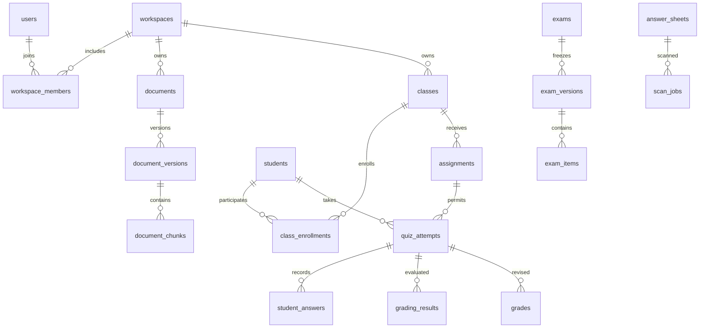

# Eduvia PostgreSQL Database Design

Status: proposed core domain schema and illustrative DDL. Updated: 2026-10-20. Blueprint and student-learning extensions remain proposals, not migrations.

The source scaffold includes only an Alembic bootstrap for the edu namespace and pgvector extension; the domain tables and RLS below are not implemented migrations. See [DEVELOPMENT.md](DEVELOPMENT.md) for current setup and scope.

## 1. Scope and conventions

This document specifies the core data model proposed in [ARCHITECTURE.md](ARCHITECTURE.md), grounded in [README.md](README.md). [EXAM_BLUEPRINTS.md](EXAM_BLUEPRINTS.md) extends core assessment design; [STUDENT_LEARNING.md](STUDENT_LEARNING.md) defines the independently owned learner database. [IMPLEMENTATION_PLAN.md](IMPLEMENTATION_PLAN.md) sets migration/delivery order. Names and constraints are design recommendations. The frontend/API foundation exists, while domain tables and service separation remain to be implemented.

Use PostgreSQL with pgvector. See [ARCHITECTURE.md](ARCHITECTURE.md) for workflows and [README.md](README.md) for product scope. Use UUID primary keys generated by the application or `gen_random_uuid()`, `timestamptz` for instants, `date` for calendar dates, `numeric(10,2)` for scores, and `bigint` integer minor units for customer prices/charges. Provider cost estimates use `numeric(20,10)` with currency to preserve sub-cent costs until aggregation. JSONB stores bounded flexible payloads, not relationships or access control. Use checked text values for small state sets so migrations remain explicit. Store UTC and render Asia/Ho_Chi_Minh or the user's configured timezone at the UI.

The following tenant conventions apply to core teacher/classroom workspace data, not personal learner-service tables or the future standalone assessment extension described in section 16. Unless stated otherwise, every tenant table includes `id uuid PK`, `workspace_id uuid NOT NULL FK workspaces(id)`, `created_at timestamptz NOT NULL`, and `UNIQUE(workspace_id,id)`. Mutable aggregates also include `updated_at` and `lock_version integer NOT NULL DEFAULT 0`. Every tenant-to-tenant relation uses a composite FK `(workspace_id, parent_id) → parent(workspace_id,id)`, even where the catalog abbreviates this as FK. This blocks cross-workspace association independently of RLS. Do not use nullable workspace IDs to mix shared catalog and private documents.

Fields listed with `?` are nullable; other listed domain fields are required unless a default is described. Catalog tables are specifications beyond the representative DDL in section 12; implementation migrations must supply their constraints and policies. No table is exposed until its operation-specific policies and API serializers exist.

## 2. Ownership and cardinalities



Users are global login identities; students are workspace-local educational records. One user may map to student records in multiple workspaces without merging their school records. A student can initially have no login account for teacher-managed paper assessment. An account-linked student must have an active student membership before portal access. A student belongs to many classes through enrollments; a class has many teachers through `class_teachers`.

One personal workspace has one immutable owning user, with a partial unique index preventing multiple active personal workspaces per user. School workspaces have explicit owner/admin memberships. The personal owner must remain an active owner member; enforce creation/removal through locked service transactions or a deferred integrity trigger. School ownership changes require a transaction ensuring at least one active owner remains. A school membership never grants access to the user's personal workspace.

## 3. Identity, permissions, and sharing catalog

| Entity | Domain columns and constraints |
|---|---|
| users (global) | `id uuid PK`, `auth_issuer text`, `auth_subject text`, `email text?`, `display_name text`, `status text`, `created_at timestamptz`; unique `(auth_issuer,auth_subject)`. Email is contact data, not primary identity. Do not store local passwords if using external identity. |
| workspaces (global root) | `id uuid PK`, `kind text CHECK personal/school`, `name text`, `personal_owner_id uuid? FK users`, `status text CHECK active/suspended/closed`, `deleted_at timestamptz?`, timestamps; personal requires owner and school requires null personal owner. |
| workspace_members | `user_id uuid FK users`, `role text CHECK owner/admin/teacher/student`, `status text CHECK invited/active/suspended/left`, `joined_at timestamptz?`, `left_at timestamptz?`; unique `(workspace_id,user_id)`. A single role per workspace is adequate initially; an existing staff role must not be overwritten by student invitation redemption. Personal workspaces contain one teacher owner plus their student memberships. |
| workspace_invites | `email_normalized text?`, `role text`, `token_hash text UNIQUE`, `expires_at timestamptz`, `accepted_by uuid? FK users`, `accepted_at timestamptz?`, `revoked_at timestamptz?`; store hash only; single-use redemption under lock. |
| teacher_profiles | `user_id uuid FK users`, `preferences jsonb`, `preferred_template_id uuid?`, `language text`; unique `(workspace_id,user_id)`; preferences may differ by school/personal workspace. |
| roles / permissions / role_permissions (global) | Seeded permission keys and role mapping, optional from phase 1; roles remain fixed in MVP. If used, application and DB helpers consume the same mapping. Arbitrary custom roles are future. |
| platform_admins (control plane) | `user_id uuid PK FK users`, `scope text`, `granted_by uuid`, timestamps; not a tenant role and not automatic data-plane access. |
| content_copy_events (future school collaboration) | `source_workspace_id uuid`, `source_item_id uuid`, `destination_item_id uuid FK content_items`, `actor_user_id uuid FK users`, `source_revision_hash text`, `rights_check jsonb`; workspace_id is destination. Source IDs are provenance identifiers, not authority to read source data. |
| resource_grants (future) | `resource_type text`, `resource_id uuid`, `grantee_workspace_id uuid?`, `grantee_user_id uuid?`, `permission text`, `expires_at timestamptz?`, `revoked_at timestamptz?`; exactly one grantee. Use typed grant tables or integrity triggers before implementing polymorphic resource references. |

**School upgrade:** create/accept school membership and optionally add school billing. Preserve the personal workspace and subscription independently. When school collaboration ships, an explicit copy of supported lesson plans/study guides creates destination-owned content_items/content_revisions, copies only permitted source content, and records provenance. Documents, exams, and question banks need their own typed copy workflows before support is added. Do not move student records or enrollments implicitly. A later ownership transfer requires a separate reviewed workflow, legal/rights checks, and audit. Revocable live sharing is future; never implement it as a blanket RLS exception.

## 4. Students and teaching

| Entity | Domain columns and constraints |
|---|---|
| students | `user_id uuid? FK users`, `external_ref text?`, `display_name text`, `status text`, `deleted_at timestamptz?`; partial unique `(workspace_id,user_id)` where non-null and active; similarly unique active external_ref. Minimize PII. |
| classes | `name text`, `academic_year text`, `grade_node_id uuid? FK curriculum_nodes`, `created_by uuid FK users`, `archived_at timestamptz?`; do not assume class name globally unique. |
| class_teachers | `class_id uuid FK classes`, `user_id uuid FK users`, `role text CHECK lead/teacher`, unique `(workspace_id,class_id,user_id)`; member must be active teacher/admin/owner, checked on mutation and every access. |
| class_enrollments | `class_id uuid FK classes`, `student_id uuid FK students`, `status text CHECK active/withdrawn/completed`, `enrolled_at timestamptz`, `ended_at timestamptz?`; unique `(workspace_id,class_id,student_id)`. Preserve one relationship with state changes; separate history events if needed. |
| class_invites | `class_id uuid FK classes`, `token_hash text UNIQUE`, `expires_at timestamptz`, `max_redemptions integer`, `redemption_count integer`, `revoked_at timestamptz?`; redemption transaction enforces remaining uses and creates membership/student/enrollment. |
| assignments | `class_id uuid FK classes`, `exam_version_id uuid? FK exam_versions`, `title text`, `kind text CHECK quiz/material`, `status text`, `opens_at timestamptz?`, `closes_at timestamptz?`, `time_limit_seconds integer?`, `max_attempts integer DEFAULT 1`, `score_release_policy text CHECK manual/after_close`, `solution_release_policy text CHECK manual/after_close`, `solutions_released_at timestamptz?`, `solutions_released_by uuid? FK users`, `published_at timestamptz?`; quiz requires exam version; closing time after opening. |
| assignment_materials | `assignment_id uuid FK assignments`, `content_revision_id uuid? FK content_revisions`, `document_version_id uuid? FK document_versions`, `position integer`; exactly one content target, unique `(workspace_id,assignment_id,position)`. Only a pinned, published student-audience revision or explicitly selected distribution-authorized document version can be assigned; access never extends to sibling versions or the source corpus. |

Assignment class, exam version, and timing rules are immutable after attempts begin. The MVP allows timing edits before attempts start; per-student deadline accommodations are future scope and need a separate versioned relation. Class archival or completed/withdrawn enrollment prevents new attempts and answer writes; own retained history remains available while workspace membership is active. Teacher-facing gradebook selects the latest submitted non-void attempt per student/assignment, then its current approved grade; pending grading is displayed as pending. It is not a second writable grade total. The first pilot uses one attempt by default. Voided attempts do not consume the limit, but require an authorized teacher and an audit reason; attempt numbers increase monotonically and are never reused. Completion uses active enrollments at query time as its labeled denominator and students among those enrollments with a submitted non-void attempt as numerator; historical fixed-cohort analytics are future scope. Objective groups may overlap when one item covers several objectives; display that overlap and do not sum topic scores into the exam total.

Both release policies default to `manual`. `after_close` requires a finite `closes_at`. Scores release through `grades.released_at`. Solutions release through the assignment-level timestamp only after the assignment no longer permits new attempts and all in-progress attempts have ended. Do not release explanations with an ordinary score response. Regrading creates an unreleased revision by default; re-release is explicit and audited. Already delivered information cannot be recalled by clearing a timestamp.

## 5. Curriculum, rights, documents, and retrieval

Global curriculum tables contain metadata; licensed source text is separately protected.

| Entity | Domain columns and constraints |
|---|---|
| curriculum_nodes (global) | `id uuid PK`, `parent_id uuid? FK self`, `kind text CHECK level/grade/subject/series/chapter/lesson/objective`, `code text`, `title text`, `language text`, `edition text?`, `position integer`; unique scoped code per parent/edition. Prevent cycles and validate parent-kind hierarchy in service or trigger. |
| knowledge_licenses (catalog) | `id uuid PK`, `licensor text`, `agreement_ref text`, `allowed_operations text[]`, `valid_from timestamptz`, `valid_until timestamptz?`, `status text`, `restrictions jsonb`, `revision integer`; restricted operator access. |
| workspace_knowledge_entitlements | `license_id uuid FK knowledge_licenses`, `starts_at timestamptz`, `ends_at timestamptz?`, `status text`; unique `(workspace_id,license_id,starts_at)`. Entitlement does not supersede agreement restrictions. |
| shared_documents (catalog) | `id uuid PK`, `license_id uuid FK knowledge_licenses`, `title text`, `curriculum_node_id uuid? FK curriculum_nodes`, `active_version_id uuid?`, `status text`; active version must belong to this document. |
| shared_document_versions (catalog) | `id uuid PK`, `document_id uuid FK shared_documents`, `version_no integer`, `object_key text`, `checksum text`, `status text`, `created_at timestamptz`; unique `(document_id,version_no)` and `(document_id,id)`. |
| shared_document_chunks (catalog) | `id uuid PK`, `document_version_id uuid FK shared_document_versions`, `ordinal integer`, `text_content text`, `location jsonb`, `search_vector tsvector`, `embedding vector(1536)?`, `embedding_model text?`; unique `(document_version_id,ordinal)`; dimension is provisional. |
| storage_objects | `object_key text UNIQUE`, `purpose text`, `mime_type text`, `byte_size bigint CHECK >=0`, `sha256 text?`, `reserved_bytes bigint CHECK >=0`, `upload_expires_at timestamptz?`, `state text CHECK pending/quarantined/ready/deleting/deleted`, `uploaded_by uuid FK users`, `deleted_at timestamptz?`; all tenant binaries referenced here; pending uploads may lack a checksum, ready objects require it. |
| storage_quotas | `live_bytes bigint`, `held_bytes bigint`, `limit_bytes bigint`; unique workspace_id, nonnegative counters. Lock this row when reserving an upload or generated artifact. |
| documents | `title text`, `uploaded_by uuid FK users`, `curriculum_node_id uuid? FK curriculum_nodes`, `rights_attested_at timestamptz`, `active_version_id uuid?`, `deleted_at timestamptz?`; owner is workspace, uploader is attribution only. |
| document_versions | `document_id uuid FK documents`, `version_no integer`, `storage_object_id uuid FK storage_objects`, `checksum text`, `parser_version text`, `chunker_version text`, `status text CHECK pending/processing/ready/failed/withdrawn`, `error_code text?`; unique `(workspace_id,document_id,version_no)`. |
| document_chunks | `document_version_id uuid FK document_versions`, `ordinal integer`, `text_content text`, `token_count integer`, `location jsonb`, `search_vector tsvector`, `embedding vector(1536)?`, `embedding_model text?`; unique `(workspace_id,document_version_id,ordinal)`. Ready versions are immutable. |

Education levels, school grades, subjects, textbooks, chapters, lessons, and learning objectives are represented by typed `curriculum_nodes`; this avoids duplicating parallel hierarchies. A future normalized catalog may replace it if curriculum relationships become many-to-many. `question_objectives` is a typed join to objective nodes; publication copies those mappings into `exam_item_objectives`. Objective nodes used by published exams retain their semantic identity; a revised objective gets a new node, while snapshot labels preserve historical display.

Storage quota reservations live on pending `storage_objects`; reserve expected maximum bytes, reconcile actual bytes at completion, and release abandoned uploads after expiry. Count retained versions, exports, and scans in live bytes. Decrement live bytes only after confirmed object deletion; reconcile counters against object metadata. This quota does not reset monthly.

Default retrieval uses active ready versions; explicit historical pins still require ready/non-withdrawn status and fresh authorization. Version rows and active-version pointers require composite ownership constraints; use a deferred FK to resolve the document/version insertion cycle. Shared catalog and private tables have separate policies. Shared text access requires active license + active workspace entitlement + allowed operation and must not be generally readable by authenticated users. Prefer a narrow retrieval interface over raw catalog SELECT grants. Source objects are also subject to license-aware download checks.

For hybrid retrieval, start with GIN on `search_vector` and a B-tree on workspace/version/status metadata. Add HNSW cosine indexes only after measuring corpus size and filtered recall. Exact vector scans may be sufficient for the pilot. ANN filtering may return too few authorized rows; tune search effort or use exact search within the authorized subset. Never loosen authorization to fill the result set. Re-embedding into another dimension requires a parallel column/table and index with a versioned cutover.

## 6. AI content and provenance

| Entity | Domain columns and constraints |
|---|---|
| content_templates | `kind text`, `name text`, `version_no integer`, `schema jsonb`, `body jsonb`, `created_by uuid FK users`; published template versions immutable. |
| content_items | `kind text CHECK lesson_plan/study_guide`, `title text`, `created_by uuid FK users`, `status text`, `current_revision_id uuid?`, `deleted_at timestamptz?`; no embedded exam key. |
| content_revisions | `content_item_id uuid FK content_items`, `revision_no integer`, `body jsonb`, `template_id uuid? FK content_templates`, `generation_job_id uuid? FK generation_jobs`, `status text CHECK draft/in_review/published/archived`, `audience text CHECK teacher/student`, `reviewed_by uuid? FK users`, `reviewed_at timestamptz?`, `published_at timestamptz?`; unique `(workspace_id,content_item_id,revision_no)`, immutable once published. |
| generation_jobs | `background_job_id uuid FK background_jobs UNIQUE`, `requested_by uuid FK users`, `purpose text`, `input jsonb`, `prompt_version text`, `provider text`, `model text`, `provider_request_id text?`, `output jsonb?`, `validation_status text`, `input_tokens bigint?`, `output_tokens bigint?`; keep private raw payloads on restricted retention. |
| generation_sources | `generation_job_id uuid FK generation_jobs`, `private_chunk_id uuid? FK document_chunks`, `shared_chunk_id uuid? FK shared_document_chunks`, `citation_label text`, `source_hash text`, `rank integer`; exactly one chunk FK. Tenant-local private FK and globally entitled shared FK are distinct. |
| export_jobs | `background_job_id uuid FK background_jobs UNIQUE`, `content_revision_id uuid? FK content_revisions`, `exam_version_id uuid? FK exam_versions`, `format text CHECK docx/pdf`, `audience text CHECK teacher/student`, `storage_object_id uuid? FK storage_objects`, `template_version text`; exactly one source. |

Current revision pointers on `content_items` and `questions` must use `(workspace_id,id,current_revision_id)` FKs to matching `(workspace_id,parent_id,id)` keys on their revision tables, as with documents in section 12. Teacher and student exports use separate objects and authorization. Never reuse a teacher export as student material; student editions omit keys, private notes, and unreleased solutions.

Source identifiers remain stable. Do not cascade-delete historical provenance when source text is withdrawn; either tombstone/redact the source row, or copy a minimal allowed metadata snapshot and retain the reference. License-specific retention determines whether text can remain. Source selection is reauthorized at execution time, not only when the job is created.

## 7. Exams, attempts, answers, and grades

| Entity | Domain columns and constraints |
|---|---|
| questions | `created_by uuid FK users`, `current_revision_id uuid?`, `status text`, `deleted_at timestamptz?`; bank identity only. |
| question_revisions | `question_id uuid FK questions`, `revision_no integer`, `kind text CHECK single_choice/short_answer/essay`, `stem jsonb`, `difficulty text`, `explanation jsonb?`, `generation_job_id uuid?`; unique `(workspace_id,question_id,revision_no)`. Only single_choice authoring/delivery/auto-grading ships in the first pilot; other kind values reserve future schema scope. |
| question_options | `question_revision_id uuid FK question_revisions`, `option_key text`, `body jsonb`, `position integer`; unique option_key and position per revision. Correctness stored in restricted key tables, not student option DTOs. |
| question_revision_keys | `question_revision_id uuid FK question_revisions UNIQUE`, `key jsonb`, `rubric jsonb?`; staff/scoring access only. |
| question_objectives | `question_revision_id uuid FK question_revisions`, `objective_node_id uuid FK curriculum_nodes`; unique pair and objective-kind validation. |
| exams | `title text`, `created_by uuid FK users`, `status text`, `deleted_at timestamptz?`; stable exam identity. |
| exam_versions | `exam_id uuid FK exams`, `version_no integer`, `status text CHECK draft/published/archived`, `published_at timestamptz?`, `published_by uuid? FK users`, `total_points numeric(10,2)`, `content_hash text`; unique `(workspace_id,exam_id,version_no)`. |
| exam_items | `exam_version_id uuid FK exam_versions`, `source_question_revision_id uuid? FK question_revisions`, `position integer`, `kind text`, `stem jsonb`, `options jsonb`, `points numeric(10,2)`; unique version/position. Snapshot is authoritative even after bank changes. Options have stable unique keys. |
| exam_item_objectives | `exam_version_id uuid FK exam_versions`, `exam_item_id uuid FK exam_items`, `objective_node_id uuid FK curriculum_nodes`, `objective_code_snapshot text`, `objective_title_snapshot text`; unique item/objective; same-version item FK. Immutable after publication. |
| answer_keys | `exam_item_id uuid FK exam_items UNIQUE`, `key jsonb`, `scoring_rule_version text`, `explanation jsonb?`; server-only immutable snapshot. |
| quiz_attempts | `assignment_id uuid FK assignments`, `exam_version_id uuid FK exam_versions`, `student_id uuid FK students`, `attempt_no integer`, `mode text CHECK online/paper`, `status text CHECK in_progress/submitted/graded/void`, `started_at timestamptz`, `deadline_at timestamptz?`, `submitted_at timestamptz?`, `submission_recorded_at timestamptz?`, `submission_reason text? CHECK student/deadline/teacher_paper`, `idempotency_key text`, `request_hash text`; unique assignment/student/attempt_no and assignment/student/idempotency_key. |
| student_answers | `attempt_id uuid FK quiz_attempts`, `exam_version_id uuid FK exam_versions`, `exam_item_id uuid FK exam_items`, `response jsonb`, `answer_revision integer`, `saved_at timestamptz`; unique attempt/item; same-version composite FKs required. |
| grading_results | `attempt_id uuid FK quiz_attempts`, `exam_version_id uuid FK exam_versions`, `scan_job_id uuid? FK scan_jobs`, `input_hash text`, `run_key text`, `algorithm_version text`, `source text CHECK online/omr/manual`, `raw_score numeric(10,2)`, `max_score numeric(10,2)`, `status text CHECK proposed/approved/rejected`, `supersedes_id uuid? FK self`; unique `(workspace_id,attempt_id,run_key)`. |
| grading_result_items | `grading_result_id uuid FK grading_results`, `exam_version_id uuid FK exam_versions`, `exam_item_id uuid FK exam_items`, `effective_response jsonb`, `answer_source text CHECK submitted/omr/review/blank`, `awarded_points numeric(10,2)`, `max_points numeric(10,2)`, `recognized_response jsonb?`, `reason text?`; unique result/item, bounded points. |
| grades | `attempt_id uuid FK quiz_attempts`, `grading_result_id uuid FK grading_results`, `revision_no integer`, `score numeric(10,2)`, `max_score numeric(10,2)`, `is_current boolean`, `approved_by uuid? FK users`, `approval_mode text CHECK automatic/teacher`, `approved_at timestamptz`, `released_at timestamptz?`, `reason text?`; unique attempt/revision, partial unique current grade per attempt. |

Before publication validate at least one item, at least two options for single-choice items, exactly one correct option, legal keys, positive points, and exam total equal to sum of items. Cross-row sums and option-key validation need a publishing transaction/trigger, not a simple CHECK. Freeze published items, keys, and objective mappings with database mutation guards and service permissions. A non-null publication timestamp permanently freezes their payloads, including after archival; archival is not a path back to editable draft. Referenced bank revisions are also immutable. Lifecycle metadata changes are narrowly permitted and audited.

Attempt start validates active enrollment, assignment publication/window, and attempt quota under an assignment/student lock. Return an existing in-progress attempt even if the caller supplies a new idempotency key; enforce a partial unique index on `(workspace_id,assignment_id,student_id) WHERE status='in_progress'`. An idempotency key reused with a different request_hash is a conflict. The effective deadline is the earliest non-null value of closes_at and started_at plus time_limit_seconds; both absent means no deadline. Enforce assignment's pinned exam version with `(workspace_id,assignment_id,exam_version_id)` FK and a matching unique constraint on assignments. Answers enforce the attempt's exam version and item membership with composite FKs. Validate response options against snapshot options before saving. Submission locks the attempt; answer writes acquire the same lock/check state and deadline, preventing a submit/autosave race. Students cannot UPDATE answer or attempt rows directly through generic data endpoints. Check fresh wall-clock time after obtaining the lock (for example, PostgreSQL clock_timestamp()); now()/CURRENT_TIMESTAMP reflect transaction start and must not be used to extend a deadline after lock waiting. Reject online answer writes at or after deadline_at. Late submit/deadline sweeping freezes only previously saved answers, sets submitted_at to the effective deadline, and records actual processing time in submission_recorded_at; it accepts no late answer payload. Apply this sweeper only to online attempts. Withdrawal prevents new writes but allows own retained history while workspace membership remains active.

Regrading and overrides append new results and grade revisions. Finalization locks the attempt, clears previous `is_current`, inserts the new current revision, and appends audit in one transaction. Enforce result/grade attempt identity using composite FKs. Each grading result has `(workspace_id,attempt_id,exam_version_id)` FK to its attempt and unique `(workspace_id,id,exam_version_id)` and `(workspace_id,attempt_id,id)`. Each result item references both `(workspace_id,grading_result_id,exam_version_id)` and `(workspace_id,exam_version_id,exam_item_id)`, rejecting an item from another exam in the same workspace. Grades reference `(workspace_id,attempt_id,grading_result_id)`; supersedes_id must reference a result for the same attempt. Require `0 <= score <= max_score`, positive maximums, and teacher approval to have an approved_by user. Snapshot every item's effective response (including blanks) and input hash in the result before approval, so later corrections never change the evidence for an older grade. Within the finalization transaction, validate that result totals equal their item totals, item maximums equal frozen exam points, and official grade totals equal the approved result. Automated approval is allowed for deterministic online objective grading; OMR requires teacher approval in the first OMR release. Future essay suggestions remain proposed until approved. Class and topic aggregates are derived views/materializations with rebuildable data; a `student_progress` projection is future, not a second source of truth.

## 8. Scanning, review, and audit

| Entity | Domain columns and constraints |
|---|---|
| sheet_templates (global metadata) | `id uuid PK`, `version text UNIQUE`, `layout jsonb`, `checksum text`, `status text`; no tenant/student data. |
| answer_sheets | `attempt_id uuid FK quiz_attempts UNIQUE`, `template_id uuid FK sheet_templates`, `public_token uuid UNIQUE`, `signature_key_version text`, `layout_mapping jsonb`, `mapping_hash text`, `issued_at timestamptz`, `revoked_at timestamptz?`; bindings derive from the immutable paper attempt; layout_mapping freezes each bubble position to an exam item and stable option key. Fixed item/option order only in the first OMR release. |
| scan_jobs | `background_job_id uuid FK background_jobs UNIQUE`, `answer_sheet_id uuid FK answer_sheets`, `attempt_id uuid FK quiz_attempts`, `exam_version_id uuid FK exam_versions`, `image_object_id uuid FK storage_objects`, `detector_version text`, `status text`, `quality_metrics jsonb`, `accepted_at timestamptz?`, `is_current_accepted boolean DEFAULT false`; many scans per sheet, partial unique current accepted scan per sheet; preserve accepted_at when replacing the current scan. |
| scanned_documents | `scan_job_id uuid FK scan_jobs`, `storage_object_id uuid FK storage_objects`, `kind text CHECK original/normalized/crop`, `page_no integer`, `region_key text`, `transform jsonb?`; unique scan/kind/page/region_key so a page can have multiple answer crops. |
| recognized_answers | `scan_job_id uuid FK scan_jobs`, `exam_version_id uuid FK exam_versions`, `exam_item_id uuid FK exam_items`, `raw_marks jsonb`, `proposed_option_key text?`, `confidence numeric(5,4)`, `ambiguity_reason text?`; unique scan/item; confidence between 0 and 1. Raw detections immutable. |
| grading_reviews | `scan_job_id uuid? FK scan_jobs`, `grading_result_id uuid FK grading_results`, `reviewer_id uuid FK users`, `decision text CHECK approve/reject/correct`, `corrections jsonb`, `reason text`, `reviewed_at timestamptz`; append-only corrections preserve detection provenance. |
| audit_events | `actor_user_id uuid? FK users`, `actor_kind text`, `action text`, `target_type text`, `target_id uuid?`, `request_id text`, `occurred_at timestamptz`, `metadata jsonb`; append-only, restricted reads; target IDs are event references rather than polymorphic cascading FKs. |
| deletion_requests | `subject_user_id uuid? FK users`, `requested_by uuid FK users`, `scope jsonb`, `status text`, `requested_at timestamptz`, `completed_at timestamptz?`, `retention_reason text?`; auditable staged erasure. |

Scan jobs must match their sheet's attempt and its exam version using composite FKs (add matching composite unique keys to parent rows). Recognized answers must match the scan's exam version and exam item. OMR grading results require a non-null scan_job_id tied to that same attempt/exam; other sources leave it null. Reviews must reference a result and, when present, its exact scan; validate this in a constrained review procedure/trigger. On teacher approval, atomically freeze the effective answers, submit the paper attempt with reason teacher_paper, approve the result, update the current accepted scan/current grade, and append the review/audit. Subsequent rescans append results and preserve earlier evidence. Paper attempts do not accept student autosave and are never automatically submitted by the online deadline worker.

A signed QR is an identifier-validation mechanism, not authorization. Validate sheet-to-attempt-to-exam relationships before recognition/finalization. Never infer tenant ownership from image metadata or client-submitted QR fields. Original images and crops use short-lived authorized downloads and configurable retention. Audit entries preserve old/new score metadata and reasons without copying full student answers or image payloads.

## 9. Jobs, billing, and usage

| Entity | Domain columns and constraints |
|---|---|
| background_jobs | `kind text`, `state text`, `requested_by uuid FK users`, `idempotency_key text`, `request_hash text`, `attempt_count integer`, `lease_generation bigint DEFAULT 0`, `lease_until timestamptz?`, `last_dispatched_at timestamptz?`, `next_run_at timestamptz?`, `progress integer`, `error_code text?`, `result_ref jsonb?`; unique workspace/requested_by/kind/idempotency_key, progress 0–100. System jobs use a dedicated service principal; claims increment lease_generation and commits must match it. |
| outbox_events | `event_type text`, `aggregate_id uuid`, `payload jsonb`, `available_at timestamptz`, `published_at timestamptz?`, `delivery_attempts integer`; inserted in domain transaction, duplicate delivery allowed. Payload carries IDs rather than private text. |
| plans (global) | `id uuid PK`, `code text`, `version integer`, `name text`, `currency char(3)`, `price_minor bigint`, `billing_interval text`, `active boolean`; unique code/version. Prices are configuration hypotheses. |
| plan_entitlements (global) | `plan_id uuid FK plans`, `feature_key text`, `limit_value bigint?`, `is_unlimited boolean`, `unit text`; unique plan/feature. Explicit unlimited semantics; null must not ambiguously mean missing or unlimited. |
| subscriptions | `plan_id uuid FK plans`, `provider text`, `provider_subscription_id text?`, `status text`, `period_start timestamptz`, `period_end timestamptz`, `cancel_at_period_end boolean`; at most one effective subscription per workspace through transaction/constraint. Free plans may be local. |
| subscription_entitlements | `subscription_id uuid FK subscriptions`, `feature_key text`, `limit_value bigint?`, `is_unlimited boolean`, `unit text`, `effective_from timestamptz`, `effective_until timestamptz?`; frozen purchased entitlements and explicit overrides. |
| usage_buckets | `feature_key text`, `period_start timestamptz`, `period_end timestamptz`, `used_units bigint`, `reserved_units bigint`, `limit_units bigint?`, `is_unlimited boolean`; unique workspace/feature/period; counters nonnegative. Lock for quota reservation. |
| usage_reservations | `bucket_id uuid FK usage_buckets`, `background_job_id uuid FK background_jobs`, `reserved_units bigint`, `actual_units bigint?`, `status text CHECK held/settled/released/uncertain`, `expires_at timestamptz`; unique bucket/job. |
| usage_events | `reservation_id uuid? FK usage_reservations`, `background_job_id uuid? FK background_jobs`, `feature_key text`, `units bigint`, `provider_cost_amount numeric(20,10)?`, `currency char(3)?`, `event_key text`, `occurred_at timestamptz`; unique workspace/event_key; append-only signed corrections explicitly typed if used. |
| billing_events | `provider text`, `provider_event_id text`, `event_type text`, `received_at timestamptz`, `processed_at timestamptz?`, `payload_hash text`, `safe_payload jsonb`; global unique provider/event ID, workspace resolved from verified provider mapping. |

Reservation transaction locks bucket, checks `used + reserved + estimate <= limit`, creates reservation, increments reserved counter, and creates job/outbox. Settlement locks reservation and bucket, deduplicates ledger key, records actual units, decrements held estimate and increments used. Actual provider usage may exceed estimate: record incurred units, block subsequent work if over limit, and alert; never discard real cost to satisfy a CHECK. Use conservative estimates/provider output caps to bound this case. A sweeper reconciles expired reservations against real job/provider state rather than releasing potentially incurred cost blindly. Ledger is authoritative; counters must be periodically reconciled. Record distinct provider executions under distinct event keys, even when they came from the same retried job; replaying one execution must not record it twice. Quota counters and reservations ship with phase 1 using local limits. Reconcile stalled queued jobs from background_jobs even when their outbox event was previously published, because broker loss can erase a delivered message; also dispatch retry_wait jobs once next_run_at arrives. Storage quota uses the separate live-byte model in section 5.

## 10. Indexes and query design

Create indexes on FK referencing columns; PostgreSQL does not create those automatically. Lead tenant-query indexes with workspace_id. Avoid indexing every JSONB payload by default.

| Query | Recommended index |
|---|---|
| Active memberships | `workspace_members(user_id,workspace_id) WHERE status='active'` plus unique workspace/user |
| Teacher class list | `class_teachers(workspace_id,user_id,class_id)` |
| Student enrolled classes | `class_enrollments(workspace_id,student_id,status,class_id)` |
| Published assignments | `assignments(workspace_id,class_id,status,opens_at,id)` |
| Student attempts | `quiz_attempts(workspace_id,student_id,assignment_id,attempt_no DESC)` |
| Attempt responses | unique `(workspace_id,attempt_id,exam_item_id)` |
| One open attempt | unique `(workspace_id,assignment_id,student_id) WHERE status='in_progress'` |
| Current grades | unique `(workspace_id,attempt_id) WHERE is_current`; release-aware student query joins attempt |
| Document history | `document_versions(workspace_id,document_id,version_no DESC)` |
| Keyword retrieval | GIN `search_vector`; separate scope/version indexes |
| Vector retrieval | optional HNSW `embedding vector_cosine_ops` per compatible model/dimension |
| Jobs to recover | `(state,next_run_at)`, `(last_dispatched_at) WHERE state='queued'`, and `(lease_until) WHERE state='running'` |
| Unpublished outbox | `(available_at,id) WHERE published_at IS NULL` |
| Audit and usage | `(workspace_id,occurred_at DESC,id)` |
| Billing deduplication | unique `(provider,provider_event_id)` |

Use keyset pagination on `(created_at,id)` or `(occurred_at,id)` and inspect actual query plans on representative tenant sizes. Partial indexes must match predicates. Start without table partitioning; introduce time partitions for high-volume audit/usage after measurement. Validate RLS-aware query plans and filtered ANN recall separately from unfiltered benchmarks.

## 11. Row-level security and access rules

Enable and FORCE RLS for every tenant table. Runtime roles are non-owner, non-superuser, NOBYPASSRLS. Keep migrator, application, worker, catalog-ingestion, billing-ingestion, and audit writer roles separate. Do not grant TRUNCATE or broad schema creation rights. Catalog and identity tables need their own restricted policies/grants, not an assumption that global means public.

At request start the server verifies identity, active workspace status, and workspace membership and begins a DB transaction. Account suspension invalidates sessions; closed, suspended, or deleted workspaces deny ordinary data access, independently of subscription payment state. Set actor/workspace with `set_config(..., true)` so pool reuse cannot retain context. Never set these from an unverified header. RLS using application GUCs defends against missing filters and many programming mistakes; a database client with arbitrary SQL under the same role can spoof GUCs. Prevent arbitrary SQL, use parameterized statements, narrow grants, and optionally trusted stored procedures for higher assurance. RLS does not replace a secure API boundary.

| Resource | Teacher/admin/owner | Student |
|---|---|---|
| Private documents/chunks and generation | Active teaching membership; later ACL may narrow | No direct access; assigned published material through authorized endpoint |
| Classes and assignments | Assigned class teacher, or scoped admin/owner | Active enrollment and published availability |
| Attempts/answers | Authorized class teacher/admin | Own attempt, enrollment, state/deadline checks for writes |
| Keys and raw grading data | Authorized teaching/scoring operation | No SELECT grant |
| Official grades | Authorized class teacher/admin | Own released current/historical result per product policy |
| Membership/billing/audit | Specific admin permissions | No general listing |

Prefer the non-recursive invoker helper in the sample for own-membership checks. Use narrow SECURITY DEFINER helpers only where a management operation needs additional access. Fixed search_path, fully qualified names, no dynamic SQL, revoked PUBLIC execute, audited owner role, and minimal returned information are required. Bootstrap membership-table SELECT policy can expose only the caller's own row; privileged management uses restricted procedures. Never let the runtime role insert its own active membership or modify its own role through a generic endpoint.

Worker messages contain job IDs, not trusted tenant claims. A narrow dispatcher/claim procedure resolves persisted workspace/actor, checks authorization, and obtains a lease. Worker then sets verified context. At execution, recheck membership, source/license access, and job purpose. Student-triggered scoring workers need a narrowly scoped scoring capability; do not grant the student permission to read keys. Authorization revocation cancels pending user-requested generation/export. System duties such as grading already committed submissions, metering settlement, retention, and audit run under a narrowly scoped service capability rather than depending on the original requester remaining active; they grant no access to a removed user. No general worker BYPASSRLS. Periodic cross-tenant scheduler tasks use restricted procedures returning eligible IDs, then process one verified workspace per transaction.

## 12. Representative SQL DDL

The following is a self-contained illustrative core slice for a fresh schema, not the complete catalog or a production migration. It demonstrates tenant FKs, immutable exam identity relationships, and restricted RLS. Roles must be provisioned separately. Curriculum, keys, storage, outbox, and billing definitions are described above and intentionally omitted from this slice. Validate all SQL against the chosen PostgreSQL/pgvector versions before adopting it.

```sql
CREATE EXTENSION IF NOT EXISTS pgcrypto;
CREATE EXTENSION IF NOT EXISTS vector;
CREATE SCHEMA edu;

CREATE TABLE edu.users (
  id uuid PRIMARY KEY DEFAULT gen_random_uuid(),
  auth_issuer text NOT NULL,
  auth_subject text NOT NULL,
  display_name text NOT NULL,
  created_at timestamptz NOT NULL DEFAULT now(),
  UNIQUE (auth_issuer, auth_subject)
);

CREATE TABLE edu.workspaces (
  id uuid PRIMARY KEY DEFAULT gen_random_uuid(),
  kind text NOT NULL CHECK (kind IN ('personal','school')),
  name text NOT NULL,
  status text NOT NULL DEFAULT 'active' CHECK (status IN ('active','suspended','closed')),
  personal_owner_id uuid REFERENCES edu.users(id) ON DELETE RESTRICT,
  deleted_at timestamptz,
  created_at timestamptz NOT NULL DEFAULT now(),
  CHECK ((kind = 'personal' AND personal_owner_id IS NOT NULL)
      OR (kind = 'school' AND personal_owner_id IS NULL))
);
CREATE UNIQUE INDEX one_active_personal_workspace
  ON edu.workspaces(personal_owner_id)
  WHERE kind = 'personal' AND deleted_at IS NULL;

CREATE TABLE edu.workspace_members (
  id uuid PRIMARY KEY DEFAULT gen_random_uuid(),
  workspace_id uuid NOT NULL REFERENCES edu.workspaces(id),
  user_id uuid NOT NULL REFERENCES edu.users(id),
  role text NOT NULL CHECK (role IN ('owner','admin','teacher','student')),
  status text NOT NULL CHECK (status IN ('invited','active','suspended','left')),
  created_at timestamptz NOT NULL DEFAULT now(),
  UNIQUE (workspace_id,id), UNIQUE (workspace_id,user_id)
);

CREATE TABLE edu.documents (
  id uuid PRIMARY KEY DEFAULT gen_random_uuid(),
  workspace_id uuid NOT NULL REFERENCES edu.workspaces(id),
  title text NOT NULL,
  uploaded_by uuid NOT NULL REFERENCES edu.users(id),
  rights_attested_at timestamptz NOT NULL,
  active_version_id uuid,
  deleted_at timestamptz,
  created_at timestamptz NOT NULL DEFAULT now(),
  UNIQUE (workspace_id,id)
);
CREATE TABLE edu.document_versions (
  id uuid PRIMARY KEY DEFAULT gen_random_uuid(),
  workspace_id uuid NOT NULL REFERENCES edu.workspaces(id),
  document_id uuid NOT NULL,
  version_no integer NOT NULL CHECK (version_no > 0),
  checksum text NOT NULL,
  status text NOT NULL CHECK (status IN
    ('pending','processing','ready','failed','withdrawn')),
  created_at timestamptz NOT NULL DEFAULT now(),
  UNIQUE (workspace_id,id),
  UNIQUE (workspace_id,document_id,id),
  UNIQUE (workspace_id,document_id,version_no),
  FOREIGN KEY (workspace_id,document_id)
    REFERENCES edu.documents(workspace_id,id) ON DELETE RESTRICT
);
ALTER TABLE edu.documents ADD CONSTRAINT active_version_belongs_to_document
  FOREIGN KEY (workspace_id,id,active_version_id)
  REFERENCES edu.document_versions(workspace_id,document_id,id)
  DEFERRABLE INITIALLY DEFERRED;

CREATE TABLE edu.document_chunks (
  id uuid PRIMARY KEY DEFAULT gen_random_uuid(),
  workspace_id uuid NOT NULL REFERENCES edu.workspaces(id),
  document_version_id uuid NOT NULL,
  ordinal integer NOT NULL CHECK (ordinal >= 0),
  text_content text NOT NULL,
  location jsonb NOT NULL DEFAULT '{}'::jsonb,
  search_vector tsvector GENERATED ALWAYS AS
    (to_tsvector('simple'::regconfig,text_content)) STORED,
  embedding vector(1536),
  embedding_model text,
  created_at timestamptz NOT NULL DEFAULT now(),
  UNIQUE (workspace_id,id),
  UNIQUE (workspace_id,document_version_id,ordinal),
  FOREIGN KEY (workspace_id,document_version_id)
    REFERENCES edu.document_versions(workspace_id,id),
  CHECK ((embedding IS NULL) = (embedding_model IS NULL))
);
CREATE INDEX chunks_version ON edu.document_chunks(workspace_id,document_version_id);
CREATE INDEX chunks_lexical ON edu.document_chunks USING gin(search_vector);
-- Optional after measurement, with the selected compatible embedding model:
-- CREATE INDEX chunks_vector ON edu.document_chunks
-- USING hnsw (embedding vector_cosine_ops);

CREATE TABLE edu.students (
  id uuid PRIMARY KEY DEFAULT gen_random_uuid(),
  workspace_id uuid NOT NULL REFERENCES edu.workspaces(id),
  user_id uuid REFERENCES edu.users(id),
  display_name text NOT NULL,
  deleted_at timestamptz,
  created_at timestamptz NOT NULL DEFAULT now(),
  UNIQUE (workspace_id,id)
);
CREATE UNIQUE INDEX active_student_account
  ON edu.students(workspace_id,user_id)
  WHERE user_id IS NOT NULL AND deleted_at IS NULL;

CREATE TABLE edu.classes (
  id uuid PRIMARY KEY DEFAULT gen_random_uuid(),
  workspace_id uuid NOT NULL REFERENCES edu.workspaces(id),
  name text NOT NULL,
  created_at timestamptz NOT NULL DEFAULT now(),
  UNIQUE (workspace_id,id)
);
CREATE TABLE edu.class_enrollments (
  id uuid PRIMARY KEY DEFAULT gen_random_uuid(),
  workspace_id uuid NOT NULL REFERENCES edu.workspaces(id),
  class_id uuid NOT NULL,
  student_id uuid NOT NULL,
  status text NOT NULL CHECK (status IN ('active','withdrawn','completed')),
  created_at timestamptz NOT NULL DEFAULT now(),
  UNIQUE (workspace_id,id), UNIQUE (workspace_id,class_id,student_id),
  FOREIGN KEY (workspace_id,class_id) REFERENCES edu.classes(workspace_id,id),
  FOREIGN KEY (workspace_id,student_id) REFERENCES edu.students(workspace_id,id)
);
CREATE TABLE edu.exams (
  id uuid PRIMARY KEY DEFAULT gen_random_uuid(),
  workspace_id uuid NOT NULL REFERENCES edu.workspaces(id),
  title text NOT NULL,
  created_at timestamptz NOT NULL DEFAULT now(),
  UNIQUE (workspace_id,id)
);
CREATE TABLE edu.exam_versions (
  id uuid PRIMARY KEY DEFAULT gen_random_uuid(),
  workspace_id uuid NOT NULL REFERENCES edu.workspaces(id),
  exam_id uuid NOT NULL,
  version_no integer NOT NULL CHECK (version_no > 0),
  status text NOT NULL CHECK (status IN ('draft','published','archived')),
  total_points numeric(10,2) NOT NULL CHECK (total_points >= 0),
  published_at timestamptz,
  published_by uuid REFERENCES edu.users(id),
  CHECK ((status = 'draft' AND published_at IS NULL AND published_by IS NULL)
      OR (status IN ('published','archived') AND published_at IS NOT NULL
          AND published_by IS NOT NULL)),
  created_at timestamptz NOT NULL DEFAULT now(),
  UNIQUE (workspace_id,id), UNIQUE (workspace_id,exam_id,version_no),
  FOREIGN KEY (workspace_id,exam_id) REFERENCES edu.exams(workspace_id,id)
);
CREATE TABLE edu.exam_items (
  id uuid PRIMARY KEY DEFAULT gen_random_uuid(),
  workspace_id uuid NOT NULL REFERENCES edu.workspaces(id),
  exam_version_id uuid NOT NULL,
  position integer NOT NULL CHECK (position > 0),
  kind text NOT NULL CHECK (kind IN ('single_choice','short_answer','essay')),
  stem jsonb NOT NULL,
  options jsonb NOT NULL DEFAULT '[]'::jsonb,
  points numeric(10,2) NOT NULL CHECK (points > 0),
  created_at timestamptz NOT NULL DEFAULT now(),
  UNIQUE (workspace_id,id), UNIQUE (workspace_id,exam_version_id,id),
  UNIQUE (workspace_id,exam_version_id,position),
  FOREIGN KEY (workspace_id,exam_version_id)
    REFERENCES edu.exam_versions(workspace_id,id)
);
CREATE TABLE edu.assignments (
  id uuid PRIMARY KEY DEFAULT gen_random_uuid(),
  workspace_id uuid NOT NULL REFERENCES edu.workspaces(id),
  class_id uuid NOT NULL,
  exam_version_id uuid NOT NULL,
  title text NOT NULL,
  status text NOT NULL CHECK (status IN ('draft','published','closed')),
  opens_at timestamptz,
  closes_at timestamptz,
  max_attempts integer NOT NULL DEFAULT 1 CHECK (max_attempts > 0),
  time_limit_seconds integer CHECK (time_limit_seconds > 0),
  score_release_policy text NOT NULL DEFAULT 'manual'
    CHECK (score_release_policy IN ('manual','after_close')),
  solution_release_policy text NOT NULL DEFAULT 'manual'
    CHECK (solution_release_policy IN ('manual','after_close')),
  solutions_released_at timestamptz,
  solutions_released_by uuid REFERENCES edu.users(id),
  created_at timestamptz NOT NULL DEFAULT now(),
  UNIQUE (workspace_id,id), UNIQUE (workspace_id,id,exam_version_id),
  FOREIGN KEY (workspace_id,class_id) REFERENCES edu.classes(workspace_id,id),
  FOREIGN KEY (workspace_id,exam_version_id)
    REFERENCES edu.exam_versions(workspace_id,id),
  CHECK (closes_at IS NULL OR opens_at IS NULL OR closes_at > opens_at),
  CHECK ((score_release_policy <> 'after_close'
          AND solution_release_policy <> 'after_close') OR closes_at IS NOT NULL)
);
-- This sample models quiz assignments only; material assignments are in the catalog.
CREATE TABLE edu.quiz_attempts (
  id uuid PRIMARY KEY DEFAULT gen_random_uuid(),
  workspace_id uuid NOT NULL REFERENCES edu.workspaces(id),
  assignment_id uuid NOT NULL,
  exam_version_id uuid NOT NULL,
  student_id uuid NOT NULL,
  attempt_no integer NOT NULL CHECK (attempt_no > 0),
  mode text NOT NULL CHECK (mode IN ('online','paper')),
  status text NOT NULL CHECK (status IN ('in_progress','submitted','graded','void')),
  started_at timestamptz NOT NULL DEFAULT now(),
  deadline_at timestamptz,
  submitted_at timestamptz,
  submission_recorded_at timestamptz,
  submission_reason text CHECK (submission_reason IN ('student','deadline','teacher_paper')),
  idempotency_key text NOT NULL,
  request_hash text NOT NULL,
  created_at timestamptz NOT NULL DEFAULT now(),
  UNIQUE (workspace_id,id), UNIQUE (workspace_id,id,exam_version_id),
  UNIQUE (workspace_id,assignment_id,student_id,attempt_no),
  UNIQUE (workspace_id,assignment_id,student_id,idempotency_key),
  FOREIGN KEY (workspace_id,assignment_id,exam_version_id)
    REFERENCES edu.assignments(workspace_id,id,exam_version_id),
  FOREIGN KEY (workspace_id,student_id) REFERENCES edu.students(workspace_id,id),
  CHECK (deadline_at IS NULL OR deadline_at >= started_at),
  CHECK (submitted_at IS NULL OR submitted_at >= started_at),
  CHECK ((submitted_at IS NULL) = (submission_recorded_at IS NULL)),
  CHECK ((submitted_at IS NULL) = (submission_reason IS NULL)),
  CHECK (submission_recorded_at IS NULL OR submission_recorded_at >= submitted_at),
  CHECK (status NOT IN ('submitted','graded') OR submitted_at IS NOT NULL),
  CHECK (status <> 'in_progress' OR submitted_at IS NULL),
  CHECK (submission_reason IS NULL
      OR (mode = 'online' AND submission_reason IN ('student','deadline'))
      OR (mode = 'paper' AND submission_reason = 'teacher_paper')),
  CHECK (submission_reason IS DISTINCT FROM 'deadline'
      OR (deadline_at IS NOT NULL AND submitted_at = deadline_at)),
  CHECK (mode <> 'online' OR deadline_at IS NULL
      OR submitted_at IS NULL OR submitted_at <= deadline_at)
);
CREATE UNIQUE INDEX one_in_progress_attempt
  ON edu.quiz_attempts(workspace_id,assignment_id,student_id)
  WHERE status = 'in_progress';
CREATE TABLE edu.student_answers (
  id uuid PRIMARY KEY DEFAULT gen_random_uuid(),
  workspace_id uuid NOT NULL REFERENCES edu.workspaces(id),
  attempt_id uuid NOT NULL,
  exam_version_id uuid NOT NULL,
  exam_item_id uuid NOT NULL,
  response jsonb NOT NULL,
  answer_revision integer NOT NULL DEFAULT 1 CHECK (answer_revision > 0),
  saved_at timestamptz NOT NULL DEFAULT now(),
  created_at timestamptz NOT NULL DEFAULT now(),
  UNIQUE (workspace_id,id), UNIQUE (workspace_id,attempt_id,exam_item_id),
  FOREIGN KEY (workspace_id,attempt_id,exam_version_id)
    REFERENCES edu.quiz_attempts(workspace_id,id,exam_version_id),
  FOREIGN KEY (workspace_id,exam_version_id,exam_item_id)
    REFERENCES edu.exam_items(workspace_id,exam_version_id,id)
);
CREATE INDEX attempts_student
  ON edu.quiz_attempts(workspace_id,student_id,assignment_id,attempt_no DESC);
CREATE INDEX enrollments_student
  ON edu.class_enrollments(workspace_id,student_id,status,class_id);
```

Example RLS baseline below permits active workspace/member reads, staff document access, and a student's own retained attempt reads. Withdrawal from a class does not erase history while workspace membership remains active; new attempts and writes still require active enrollment. It deliberately provides no attempt writes, answer reads/writes, class reads, or key access; production adds narrowly scoped policies/procedures following section 11. Default-deny is safer than a universal workspace-member policy.

```sql
CREATE FUNCTION edu.actor_id() RETURNS uuid
LANGUAGE sql STABLE AS $$
  SELECT NULLIF(current_setting('app.user_id', true),'')::uuid
$$;
CREATE FUNCTION edu.active_workspace_id() RETURNS uuid
LANGUAGE sql STABLE AS $$
  SELECT NULLIF(current_setting('app.workspace_id', true),'')::uuid
$$;

ALTER TABLE edu.workspace_members ENABLE ROW LEVEL SECURITY;
ALTER TABLE edu.workspace_members FORCE ROW LEVEL SECURITY;
CREATE POLICY own_membership ON edu.workspace_members FOR SELECT
  USING (user_id = edu.actor_id()
         AND workspace_id = edu.active_workspace_id());

ALTER TABLE edu.workspaces ENABLE ROW LEVEL SECURITY;
ALTER TABLE edu.workspaces FORCE ROW LEVEL SECURITY;
CREATE POLICY active_member_workspace ON edu.workspaces FOR SELECT
  USING (id = edu.active_workspace_id() AND status = 'active' AND deleted_at IS NULL
    AND EXISTS (SELECT 1 FROM edu.workspace_members m
      WHERE m.workspace_id = workspaces.id AND m.user_id = edu.actor_id()
        AND m.status = 'active'));

-- Invoker helper: queries only the caller's row through own_membership.
-- It needs SELECT on workspace_members/workspaces and never recursively checks itself.
CREATE FUNCTION edu.has_role(w uuid, allowed_roles text[]) RETURNS boolean
LANGUAGE sql STABLE SECURITY INVOKER SET search_path = pg_catalog, edu AS $$
  SELECT w = edu.active_workspace_id() AND EXISTS (
    SELECT 1 FROM edu.workspace_members m
    WHERE m.workspace_id = w AND m.user_id = edu.actor_id()
      AND m.status = 'active' AND m.role = ANY(allowed_roles)
  ) AND EXISTS (SELECT 1 FROM edu.workspaces w_active
    WHERE w_active.id = w AND w_active.status = 'active' AND w_active.deleted_at IS NULL)
$$;

ALTER TABLE edu.students ENABLE ROW LEVEL SECURITY;
ALTER TABLE edu.students FORCE ROW LEVEL SECURITY;
CREATE POLICY own_student_record ON edu.students FOR SELECT
  USING (workspace_id = edu.active_workspace_id()
    AND user_id = edu.actor_id() AND deleted_at IS NULL
    AND edu.has_role(workspace_id, ARRAY['student']::text[]));

ALTER TABLE edu.documents ENABLE ROW LEVEL SECURITY;
ALTER TABLE edu.documents FORCE ROW LEVEL SECURITY;
CREATE POLICY staff_document_read ON edu.documents FOR SELECT
  USING (deleted_at IS NULL AND edu.has_role(
    workspace_id, ARRAY['owner','admin','teacher']::text[]));
CREATE POLICY staff_document_insert ON edu.documents FOR INSERT
  WITH CHECK (uploaded_by = edu.actor_id() AND edu.has_role(
    workspace_id, ARRAY['owner','admin','teacher']::text[]));
-- No general UPDATE/DELETE policy: use authorized lifecycle procedures.

ALTER TABLE edu.quiz_attempts ENABLE ROW LEVEL SECURITY;
ALTER TABLE edu.quiz_attempts FORCE ROW LEVEL SECURITY;
CREATE POLICY own_attempt_read ON edu.quiz_attempts FOR SELECT
  USING (workspace_id = edu.active_workspace_id()
    AND edu.has_role(workspace_id, ARRAY['student']::text[])
    AND EXISTS (SELECT 1 FROM edu.students s
      WHERE s.workspace_id = quiz_attempts.workspace_id
        AND s.id = quiz_attempts.student_id
        AND s.user_id = edu.actor_id() AND s.deleted_at IS NULL));

-- Remaining sample relations are explicitly default-deny until policies exist.
ALTER TABLE edu.users ENABLE ROW LEVEL SECURITY;
ALTER TABLE edu.users FORCE ROW LEVEL SECURITY;
ALTER TABLE edu.document_versions ENABLE ROW LEVEL SECURITY;
ALTER TABLE edu.document_versions FORCE ROW LEVEL SECURITY;
ALTER TABLE edu.document_chunks ENABLE ROW LEVEL SECURITY;
ALTER TABLE edu.document_chunks FORCE ROW LEVEL SECURITY;
ALTER TABLE edu.classes ENABLE ROW LEVEL SECURITY;
ALTER TABLE edu.classes FORCE ROW LEVEL SECURITY;
ALTER TABLE edu.class_enrollments ENABLE ROW LEVEL SECURITY;
ALTER TABLE edu.class_enrollments FORCE ROW LEVEL SECURITY;
ALTER TABLE edu.exams ENABLE ROW LEVEL SECURITY;
ALTER TABLE edu.exams FORCE ROW LEVEL SECURITY;
ALTER TABLE edu.exam_versions ENABLE ROW LEVEL SECURITY;
ALTER TABLE edu.exam_versions FORCE ROW LEVEL SECURITY;
ALTER TABLE edu.exam_items ENABLE ROW LEVEL SECURITY;
ALTER TABLE edu.exam_items FORCE ROW LEVEL SECURITY;
ALTER TABLE edu.assignments ENABLE ROW LEVEL SECURITY;
ALTER TABLE edu.assignments FORCE ROW LEVEL SECURITY;
ALTER TABLE edu.student_answers ENABLE ROW LEVEL SECURITY;
ALTER TABLE edu.student_answers FORCE ROW LEVEL SECURITY;

-- Bind values through the driver after authenticating and selecting workspace:
-- BEGIN;
-- SELECT set_config('app.user_id', :verified_user_uuid, true);
-- SELECT set_config('app.workspace_id', :verified_workspace_uuid, true);
-- ... scoped queries ...
-- COMMIT;
```

Provision grants explicitly; RLS alone does not grant SELECT. Revoke PUBLIC schema/function privileges where appropriate. The sample's invoker helper avoids SECURITY DEFINER entirely; more capable management helpers must follow the hardening rules in section 11. Identity bootstrap, workspace creation, membership management, scoring, and license retrieval require narrow privileged procedures or isolated services, not bypass rights on the normal application connection.

## 13. Constraints and transaction checklist

- Composite tenant FKs on every child; no inferred ownership through IDs alone.
- CHECK constraints for positive attempt numbers, nonnegative units/scores, bounded confidence, legal states, and ordered dates. Add maximum score bounds on grade/result rows.
- Partial unique indexes for one active personal workspace, active student mapping, current accepted scan, one in-progress attempt per assignment/student, and current official grade. An index alone cannot ensure at least one owner or grade exists.
- Immutable published versions, keys, detections, usage ledger, and audit events. Enforce mutation restrictions through DB privileges/triggers in addition to services.
- Lock parent attempt for all answer writes, submission, deadline closure, and grade finalization. Lock class invitation during redemption and usage bucket during reservation.
- School owner removal and personal-owner membership checks require locked transactional logic; cross-row constraints cannot be expressed as ordinary CHECK clauses.
- Only soft-delete recoverable authoring data. Avoid blanket CASCADE from users/workspaces into grades or audit. Hard purges are ordered, audited retention workflows with explicit object deletion.
- Do not infer shared-source entitlement from a FK: it proves existence, not permission or license validity.

## 14. Migration, rollout, and verification strategy

Use Alembic with reviewed, versioned SQL/SQLAlchemy migrations in the future backend. Separate schema-owner credentials from runtime credentials. Migration history and seeded permission/plan versions belong in source control; production data and secrets do not.

1. **Foundation:** identity, workspaces, memberships, curriculum/rights, storage, documents/chunks, audit, durable jobs/outbox, usage ledger/reservations/buckets, and live storage quota. Enable RLS before granting runtime access.
2. **Authoring:** content revisions/templates, generation provenance, question bank, exam snapshots, exports. Add publish guards and teacher approval transactions.
3. **Online pilot:** students/classes/enrollments, assignments, attempts/answers, grading/grades, release policies. Add concurrency and own-record access checks before student access.
4. **OMR:** templates/sheets, scans, detection/review, image retention. No handwritten OCR or essay scoring tables are needed for the first OMR release.
5. **Commercial:** subscription/payment integration, plan-linked limits, and billing reconciliation. Extend existing usage ledger rather than replacing historical usage.
6. **Future:** granular school ACLs, live sharing, departments, guardian records/consent evidence as required, attendance, tutoring, adaptive projections, batch scan grouping.

Use expand → backfill → validate → switch → contract for live changes. Add nullable columns first, backfill in small idempotent batches, validate FK/CHECK constraints, then enforce NOT NULL after measuring locks. Use concurrent index creation outside a transaction where supported. Never combine destructive schema removal with the first release that stops writing a field. Keep old/new API and worker versions compatible during rolling deployment; drain incompatible jobs before contracting payload/schema formats.

For embeddings, dual-populate a new model-specific representation, evaluate retrieval quality and authorization, then switch reads; retain rollback capability until validated. For RLS changes, run a role/workspace test matrix before and after migration. Prefer forward repair for destructive migrations; database rollback requires a rehearsed backup restore, not a promise that every downgrade is reversible.

Required verification: cross-tenant FK rejection; missing-context denial; runtime-owner/BYPASSRLS checks; membership revocation; student reads of another student's attempts/grades; key leakage; shared license expiry; concurrent attempt start, autosave and submit; duplicate grading/scan finalization; current-grade uniqueness; quota races and settlement replay; outbox recovery; PII erasure and backup tombstone replay; and restore integrity across PostgreSQL and object storage. The illustrative DDL is not a production migration: publication guards, scoring/review procedures, and the remaining catalog tables must be implemented and tested before runtime access. It has not been executed against a live PostgreSQL instance during this documentation-only review.


## 15. Implementation references

RLS policy composition, runtime role privileges, and constraint-error handling must be verified against the chosen PostgreSQL release; constraint checks are not authorization checks. See [PostgreSQL row security](https://www.postgresql.org/docs/current/ddl-rowsecurity.html). For filtered approximate vector search and its recall tradeoffs, see the [pgvector filtering guidance](https://github.com/pgvector/pgvector#filtering). Use fresh wall-clock time for deadline checks as distinguished from transaction time in the [PostgreSQL date/time reference](https://www.postgresql.org/docs/current/functions-datetime.html#FUNCTIONS-DATETIME-CURRENT). Pin tested versions during implementation.

## 16. Blueprint, skills and independent learner extensions (proposed)

### 16.1 Core-owned shared foundations

The detailed blueprint catalog and invariants in [EXAM_BLUEPRINTS.md](EXAM_BLUEPRINTS.md) extend section 7. Implement versioned blueprint identity/revisions, ordered parts, matrix cells, bounded constraints and immutable exam-to-blueprint bindings. Workspace-private blueprints and platform catalog blueprints must use separate protected ownership relations; a nullable workspace_id must not become a universal access policy. Catalog readability requires publication and appropriate entitlement, not merely an authenticated session.

An exam snapshot must pin the exact blueprint revision/hash, scoring policy, generation/assembly provenance and validation result. Subsequent template edits cannot change published exams. Publication validates joint matrix feasibility, totals, supported question kinds, same-source item grouping and audience/rights checks. Preserve referenced blueprint revisions; withdrawal blocks new authorized use without silently mutating historical attempts. A JSON schema alone cannot enforce cross-row point totals or the feasibility of joint constraints.

Add reviewed, versioned skill taxonomy and prerequisite edges with cycle checks; curriculum/objective-to-skill mappings distinguish textbook placement from transferable skills. Question-revision-to-skill links and misconception/distractor annotations require provenance and review. Published exam items freeze the relevant mapping/version so later taxonomy edits do not reinterpret historical evidence silently. Cognitive level, author-estimated difficulty and empirically calibrated difficulty are different fields, with estimator/calibration version and sample context.

These concepts do not require creating every future table in M1. Introduce blueprint single-choice support during M4; expand mappings at L0 with explicit backfill/review and migration tests.

### 16.2 Separate learner database

Student-learning owns personal profiles, goals, availability, plan revisions/tasks, permitted evidence receipts, mastery projections and recommendation history. Its logical catalog and proposed names are maintained in [STUDENT_LEARNING.md](STUDENT_LEARNING.md), not duplicated as executable DDL here. Own-record RLS uses verified learner context, non-owner runtime roles and non-null learner ownership. Local child relations enforce composite learner FKs. Learner root identity is resolved from authenticated platform identity; possession of a learner UUID is not permission.

External user, curriculum, blueprint, exam and assessment references carry source-service identity and version, not cross-database foreign keys. Validate through authorized APIs and reconcile missing/withdrawn references. No learner service SQL connection may SELECT core tables. Shared physical hosting does not grant shared schema privileges. Per-service outbox/inbox, audit, job and deletion state have local ownership; event processing deduplicates IDs and applies aggregate versions.

Classroom `students` remain workspace-local records. Do not move them into a global student table or auto-copy classroom grades into personal learning history. Explicit purpose-bound grants govern imported evidence and teacher visibility. Personal mastery is a derived projection with confidence, evidence set and model version, not a grade or a school-owned permanent ability label. Corrections/retractions trigger rebuild; deleted/withdrawn evidence cannot be revived through replay.

### 16.3 Standalone assessment is an explicit core schema extension

The existing `assignments → quiz_attempts` catalog requires classes, workspace-local students and assignment membership. It cannot serve independent learners unchanged. Before L1 expose core-owned standalone assessment relations for learner-scoped sessions/attempts, immutable answers and scoring results, with the same submission/deadline/idempotency invariants as section 7. Keep their owner model separate from teacher tables; do not insert fake classes or relax all existing workspace FKs.

Implementation must choose and review concrete relation names and publication references in an ADR. The recommended approach is separate learner-owned standalone attempt/result tables using the shared core scoring application service, with an authorized immutable catalog publication reference. Private teacher exam reuse requires explicit rights-checked publication or a dedicated grant, not an unvalidated cross-scope FK. Use integer/fixed-precision scoring and versioned scoring rules as in core. Student-learning stores result/evidence references and allowed feedback only, never answer keys or another authoritative grade ledger.

Standalone assessment learner IDs are external references to the learner domain and are bound to verified identity through the service contract, not remote FKs. Core enforces subject ownership, scope, account status, entitlement and release at each operation. Service credentials alone do not authorize arbitrary learner IDs. Exactly one service owns start/save/submit/scoring state; application code shares pure scoring rules, not live table ownership.

### 16.4 Rollout and verification

M4: blueprint and frozen publication bindings. L0: reviewed skill mappings/prerequisites. L1: learner database, standalone core assessment, scoped contracts, outbox/inbox, consent and deletion propagation. L2: evidence/mastery/plans. L3: additional item types only with full authoring/delivery/scoring tests. See [delivery plan](IMPLEMENTATION_PLAN.md).

Additional checks: private/catalog blueprint isolation, immutable blueprint pinning, unsatisfiable matrix rejection, unsupported type rejection, learner A/B isolation, unauthorized teacher access, spoofed external references, event replay/reordering, score correction supersession, missing source permissions, learner-scoped quota races and erasure convergence after independent database restores. The SQL in section 12 is unchanged illustrative teacher-pilot DDL and does not implement these extensions.

## 17. School staff management extension (2026-10-21 proposal)

[SCHOOL_MANAGEMENT.md](SCHOOL_MANAGEMENT.md) owns the detailed logical catalog and H0–H4 acceptance gates. Reuse workspaces, workspace_members and workspace_invites for school identities; add school staff profiles, departments/member links, academic years/terms, teaching assignments, typed scoped grants, work requirements, revision-pinned review requests/decisions, handover records and optional budget allocations as each slice ships. These are proposed tables, not implemented migrations.

Every school-owned relation has non-null workspace_id, composite tenant FKs and operation-specific RLS. A staff profile does not create an independent authorization identity: active membership and current scoped grant remain required. Staff employee codes are unique within the school when present; global users may have independent profiles across schools. Protect last active owner against concurrent suspension/transfer. Department membership alone must not grant school-wide grade or key access.

Choose teaching_assignments as the single assignment authority; maintain existing class_teachers transactionally as compatibility/projection if retained. Validate membership and effective dates on commands as well as references, since an FK cannot prove a teacher is currently authorized. Grant targets and review targets use typed references with integrity checks, not arbitrary JSON permissions. Approval binds an exact revision and becomes inapplicable to new edits. History preserves authorship, result revisions and handover provenance.

Existing illustrative staff document policies are not sufficient for granular school rollout; narrow them to the adopted ownership/department/class grants before exposing school dashboards. Test school A/B isolation, personal-workspace isolation, no automatic learner-data access, expired scopes, last-owner races, invite replay, handover and restore/revocation. No new payroll/HR-sensitive data or generic school-wide export is implied.
